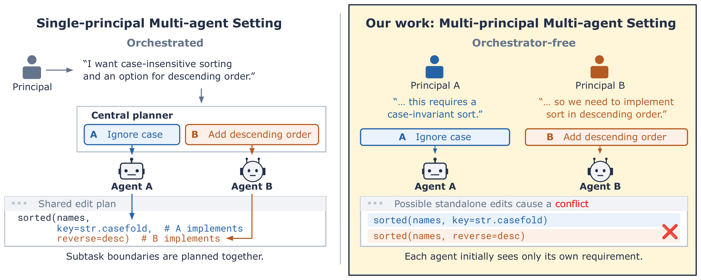
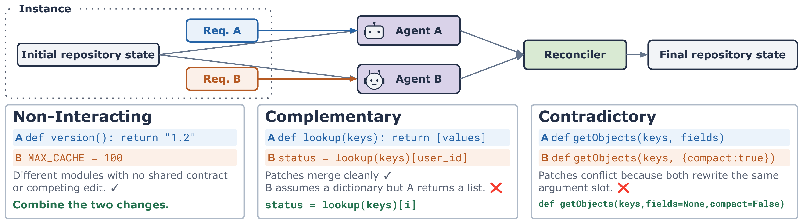

<h1 align="center">ParallACT: Decentralized Multi-Agent Coordination and Communication in Shared Codebases</h1>

<p align="center">
  <a href="https://lingyunxiao18.github.io/ParallACT/"></a>
  <a href="https://arxiv.org/abs/2611.00314"></a>
  <a href="https://x.com/EliasEskin/status/2117659177514357181?a=lhE7hJJNxSDdR4nB_Y8&s=20"></a>
</p>

<p align="center">
  <a href="https://www.linkedin.com/in/rishabh-mediratta/">Rishabh Mediratta</a>&nbsp;&nbsp;
  <a href="https://www.linkedin.com/in/lingyun-richard-xiao/">Lingyun Xiao</a>&nbsp;&nbsp;
  <a href="https://www.cs.utexas.edu/~pstone/">Peter Stone</a>&nbsp;&nbsp;
  <a href="https://www.joydeepb.com/">Joydeep Biswas</a>&nbsp;&nbsp;
  <a href="https://esteng.github.io/">Elias Stengel-Eskin</a>
</p>

## Overview

Coding agents working in shared repositories may receive separate, independently-motivated requests from human developers, creating a set- ting that is multi-agent by necessity. When this scenario happens, their individual implementations may work separately but conflict when combined. To study this setting, we introduce ParallACT, a benchmark of orchestrator-free multi-agent coding tasks. ParallACT contains both complementary and contradictory tasks. In complementary tasks, each agent’s task is separately useful and implementations must share an interface to be productively combined. In contradictory pairs, both agents’ tasks require editing the same code in incompatible ways, and naively combining independent solutions fails to produce a useful implementation. We compare a single-agent oracle given the combined set of tasks against multi-agent settings that vary execution order, visibility, awareness of other agents, and access to a communication channel. We find that the oracle solves most tasks while parallel agents perform substantially worse. Their performance drop is notable for complementary tasks, and particularly sharp for contradictory tasks (e.g., from 62% to 16% for Claude Code with Claude Opus 4.8) where merged code typically satisfies only one specification, and the same gap appears in all six further configurations pairing two agent harnesses with three open-weight models. Simply telling an agent that a peer exists does not help significantly, and giving agents access to a communication channel recovers only a small part of the performance, at an additional token cost. ParallACT thus identifies and isolates a core challenge that will become more common as multi-agent coding by independent principals becomes standard, and provides a controlled test of which coordination strategies help, and at what cost.

<p align="center">
  
</p>
<p align="center"><em>Left: a central planner splits one request across agents. Right: in ParallACT, separate principals give each agent its own request, and individually valid edits can conflict when combined.</em></p>
<p align="center">
  
</p>
<p align="center"><em>Each agent gets its own requirement on the same repository, and a reconciler combines their edits. Complementary tasks must agree on a shared interface; contradictory tasks edit the same code in incompatible ways.</em></p>

This repository contains the ParallACT dataset and the code used to build, run, and evaluate it.

## Layout

```
dataset/
  v1/generated/{contradictory,complementary}/   58 instances
  v1/seeds/{contradictory,complementary}/       27 instances
  v2/generated/{contradictory,complementary}/   70 instances
prelim_suggestions/     1. pick candidate SWE-bench Pro tasks and rank them
author_new_instances/   2. author instances from the ranked candidates and verify them
running_instances/      3. serve a model and run agent harnesses on the instances
eval/                   4. grade the run bundles
```

## Setup

```bash
uv sync
```

Outside Python you need:

| for | needs |
|---|---|
| running + eval | Docker |
| running | the harness CLIs you use: `claude`, `codex`, `opencode` supported |
| running (`*_redis` scenarios) | `redis-server` |
| running | an OpenAI/Anthropic-compatible model endpoint; `running_instances/serve_model_scripts/` serves one with vLLM |
| eval (`reconciler` strategy) | `CooperBench/Qwen2.5-Coder-0.5B-Merge-Resolver` |
| building instances | Docker, `codex`, `git`, and a model endpoint for `prelim_suggestions` |

Environment variables are listed in `.env.example`.

## Instance format

One JSON file per instance, `instance_<id>.json`:

| field | meaning |
|---|---|
| `instance_id`, `repo`, `base_commit`, `family` | identity and starting point |
| `agentA_problem_statement`, `agentB_problem_statement` | the two requests |
| `agentA_solution`, `agentB_solution` | reference implementations (diffs against `base_commit`) |
| `agentA_test_patch`, `agentB_test_patch`, `agentA_fail_to_pass`, `agentB_fail_to_pass`, `agentA_pass_to_pass` | each request's tests |
| contradictory: `reconciliation_patch`, `reconciliation_explanation`, `combined_test_patch` | a correct merge of both and the tests it must pass |
| complementary: `integration_test_patch`, `integration_fail_to_pass` | the integration tests over both halves |
| `mutex_type`, `shared_artifact`, `diversity_mechanism`, `natural_language_explanation` | what the two requests share and why they interact |
| `runtime` | `image_uri`, `run_script`, `parser`, `selected_test_files_to_run`, `before_repo_set_cmd`, `repo_language` |

## Usage

Run one harness x model over a corpus (from `running_instances/common/`):

```bash
uv run python run.py --harness codex --model qwen --corpus v2 --scenario-concurrency 8
```

Bundles go to `run_outputs/<corpus>/<harness>__<model>/<label>/<family>/<instance_id>/<scenario>/`.
See `running_instances/README.md`.

**Grade** (from the repo root):

```bash
EVAL_RUN_TIMEOUT=2400 uv run python -m eval.grade --corpus v2 --family both --jobs 4
```

Results go to `eval_outputs/<corpus>/...`, one JSON per scenario plus a
`summary.json` per harness × model × label × family. See `eval/README.md`.

Build new instances: `prelim_suggestions/README.md`, then `author_new_instances/README.md`.

## Citation

```bibtex
@article{mediratta2026decentralized,
  title={Decentralized Multi-Agent Coordination and Communication in Shared Codebases},
  author={Mediratta, Rishabh and Xiao, Lingyun and Stone, Peter and Biswas, Joydeep and Stengel-Eskin, Elias},
  journal={arXiv preprint arXiv:2611.00314},
  year={2026}
}
```
